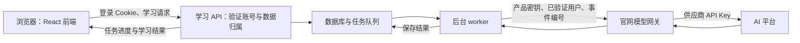

# AI Learn：账号后端与 AI 平台接入交接说明

更新日期：2026-11-17。供负责账号后端、模型网关及部署的同事参考。

本文依据当前仓库代码整理，不包含真实密钥，不代表官网生产环境已完成联调。账号系统由后端同事负责；前端继续完善学习流程，通过已有 API 对接。总体架构继续遵循《ai-learn 多租户架构改造规划》，不向旧 Gradio 系统追加过渡功能。

## 1. 当前采用的接入方式

正式网页版沿用官网统一模型网关。浏览器提交学习目标或问题，学习后端验证身份后创建任务，由后台 worker 请求网关；网关对接实际 AI 平台。用户在前端选择主模型，无需在官网学习页面填写个人 API Key。



前端负责页面、交互和进度展示；学习后端负责身份核验、数据归属、业务任务与结果保存；网关负责模型访问、上游认证及积分计量。长时间模型调用不应占用业务数据库事务或连接。

## 2. 必须区分的三类凭据

| 凭据 | 用途 | 管理位置 |
| --- | --- | --- |
| 登录会话/`learn_entry` Cookie | 证明用户已登录并具有产品资格 | 官网账号系统；按既有协议传递和核验 |
| 网关产品密钥 `LEARN_GATEWAY_PRODUCT_KEY` | 证明请求来自被允许的学习服务 | 学习 API/worker 的服务端受控配置 |
| AI 供应商 API Key | 允许网关调用某家 AI 平台并产生用量 | 网关侧受控密钥配置，具体管理方式由网关维护方确认 |

这三者不能互相替代。产品密钥不是用户登录凭证，也不是 DeepSeek/OpenAI 等供应商的 Key。普通供应商 Key 不能直接当作产品密钥使用，因为官网网关还承担账号权限与计量协议。

密钥不得进入 React 构建变量、浏览器存储、业务接口返回、Git、日志或截图。学习数据库当前只保存主模型偏好，不保存个人供应商 Key。显式本机开发模式下的个人 Key 适配是独立测试路径，不能作为正式网页版的认证或部署方案。

## 3. 已有代码与接口

以下均为仓库内已有实现入口，不要求另起一套模型客户端。

| 位置 | 当前作用 |
| --- | --- |
| `learn_core/config.py` | 读取网关地址、产品密钥及并发配置 |
| `learn_core/llm/gateway.py` | `GatewayClient`：获取模型目录、调用模型、租约及调用记录 |
| `learn_core/learning/model_settings.py` | 按当前租户读写 `tenant_setting.chat_model`，不保存密钥 |
| `learn_api/routers/models.py` | 模型目录查询、主模型选择与网关可用性校验 |
| `learn_api/routers/me.py` | 前端初始化所需账号身份和可用能力 |
| `learn_core/learning/generation.py` | 学习路线、教材及相关生成任务 |
| `learn_core/learning/conversations.py` | 持久化问答/助教任务 |
| `learn_core/learning/polish.py` | 文本润色任务 |

### 浏览器调用学习 API

| 方法与路径 | 作用 | 关键约定 |
| --- | --- | --- |
| `GET /api/v2/me` | 确认账号和能力 | 返回稳定的 `userId`、`displayName`、布尔能力对象；不含任何密钥 |
| `GET /api/v2/models` | 获取当前账号可用模型 | 返回 `items`、`selectedModel`、`selectedAvailable` |
| `PATCH /api/v2/models/selection` | 保存主模型 | 请求 `{"model":"网关返回的模型ID"}`；服务端重新校验该账号可用模型 |

前端默认生产路径为 `/official/learn-everything/api/v2`，由同源反向代理映射至学习 API 的 `/api/v2`。不要把内部网关地址放进页面组件。

### 学习后端调用网关

网关基址默认配置为 `http://127.0.0.1:18040/v1`；这只是代码默认值，部署时需核对实际地址和访问边界。

| 网关接口 | 当前客户端携带的信息 |
| --- | --- |
| `GET /models` | `Authorization: Bearer <产品密钥>`、`X-End-User`、`X-Product: learn-everything` |
| `POST /chat/completions` | 当前任务路径 `chat_detached` 携带上述信息，另加 `X-Event-Id`；body 包含 `model`、`messages` 等模型参数 |

网关采用 OpenAI 兼容协议。模型目录读取 `data` 数组中的 `id`/`owned_by`；生成结果读取 `choices[0].message.content`，可记录返回的 `usage`。各供应商原生协议差异应由网关适配，学习页面不逐家处理认证方式。

代码中还保留旧 `GatewayClient.chat` 方法，其协议细节与当前任务路径不同。后续新增学习调用应沿用已接通的任务路径，并检查用户身份、事务和脱敏要求，不应直接复制旧方法作为新入口。

## 4. 账号系统需要提供什么

账号后端不必在第一步重写学习业务，但必须提供稳定、可信的身份和资格信息。

1. 验证现有登录会话，返回稳定的官网用户标识。昵称不能作为账号主键；更换账号实现时需保留旧标识映射。
2. 通过该身份映射学习租户，所有计划、笔记、资料和任务按租户归属读取。
3. 学习服务向网关传递的 `X-End-User` 必须来源于服务端已验证身份。不能使用浏览器自由填写的用户编号。
4. 网关结合产品密钥与用户身份检查模型权限、积分及用量；服务端不能只相信前端隐藏了某个模型选项。
5. 账号切换、退出、资格失效和续期失败应返回一致语义，让旧页面及时停止。

当前登录适配为官网内部 GET authorize、204 响应和 `X-Learn-User` 返回头，并经可信代理核验。具体协议见 [official-auth.md](official-auth.md)。浏览器的 `X-Learn-Expected-User` 只是用于发现账号变化，不是授权凭据。

前端 `/me` 数据格式、缓存清理和双账号联调步骤见 [frontend-backend-handoff.md](frontend-backend-handoff.md)。若变更公开字段或登录协议，应同步前端适配与 OpenAPI。

## 5. 服务端配置方式

下面仅示意配置项，没有可用密钥，也不是一份完整部署文件：

```dotenv
LEARN_GATEWAY_URL=http://127.0.0.1:18040/v1
LEARN_GATEWAY_PRODUCT_KEY=<由网关维护方提供的产品密钥>
```

建议由进程管理器加载仓库外的受控环境文件，限制文件权限，并向需要的 API/模型 worker 注入。供应商 Key 在网关侧配置，不增加到前端环境文件。配置对象有进程级缓存，密钥轮换后应按发布流程重启受影响服务并核验，不能假设修改文件后自动生效。

数据库、文件、官网授权、可信代理等其他部署配置另见 [online-beta-handoff.md](online-beta-handoff.md)。并发数需要结合实际服务器实测；不能直接把配置默认值当成已经验收的容量。

## 6. 一次生成任务如何完成

1. 前端带登录 Cookie 提交学习目标，学习 API 核验官网身份和租户。
2. 在事务内保存业务记录及任务；任务提交与数据库记录保持一致。
3. worker 读取该任务、所属租户和模型快照，结束输入读取事务。
4. 获取受控模型调用租约，生成/使用调用事件编号，经 `GatewayClient.chat_detached` 请求网关。
5. 网关完成权限与费用处理，选择上游供应商并携带其 API Key 调用模型。
6. worker 校验输出并保存结果、任务状态及调用记录；前端通过任务事件或查询恢复展示。

**事件编号需要特别对齐：**学习生成任务仅在确认未建连时沿用相同 `X-Event-Id` 和请求内容重试，明确的 HTTP 429 重试使用新的事件编号。响应超时、传输中断或 5xx 等结果未确认时停止自动重发。仅发送事件头不代表已证明网关具有幂等计费能力，需与网关维护方确认去重范围、保留时间及断线后的处理方式。

## 7. 错误与费用处理

必须区分“浏览器未登录”与“学习服务连接网关失败”，两者不能混用。

| 情况 | 对接要求 |
| --- | --- |
| 学习 API 返回 401/403 | 当前前端视作登录/资格失效并停止会话；不要用来直接透传网关产品密钥错误 |
| 网关返回 401/403 | 排查产品密钥或模型访问权限，转换为服务/任务错误，避免误把用户登出 |
| 网关返回 402 | 提示积分不足，避免继续收费重试；现有模型目录接口映射为 `INSUFFICIENT_CREDITS` |
| 网关返回 429/暂时性 5xx | 展示忙碌/失败，由受控任务策略处理；前端不自动重复提交付费操作 |
| 网络超时或响应丢失 | 请求可能已被上游处理；核对任务和事件记录，不能简单生成新编号无限重试 |
| 返回空内容、截断或结构错误 | 当前任务客户端检查部分异常；业务层还需校验生成结果，不能把 HTTP 200 等同于课程保存成功 |

当前已有任务级重试和调用日志，但网关实际去重、账单对账、402 后全账号后台任务暂停及真实并发容量仍需确认/完善。不能将“有 `model_call` 记录”表述成完整财务结算已完成。

上游原始错误可能含内部地址或敏感信息，响应和日志应脱敏。用户可见提示给出错误类型、是否可重试及任务编号，不回传密钥和上游完整响应。

## 8. 建议实施与联调顺序

1. **先对齐身份：**稳定用户 id、资格校验、Cookie 续期、旧账号映射，以及 `/me` 返回格式。
2. **确认网关配置：**可访问基址、产品密钥来源、模型目录格式和用户身份头；确认由谁维护供应商 Key。
3. **先读后写：**两个账号分别读取模型目录、保存主模型，验证前端伪造模型 id 会被拒绝。
4. **最小真实调用：**用受控额度执行一次路线或问答，核对账号、任务、事件、模型、用量及网关账单归属。
5. **异常与隔离：**验证积分不足、限流、产品密钥失效、超时、账号切换和跨账号资源访问。
6. **两到三人并发：**检查生成/上传/测验/复习，记录 CPU、内存、队列等待、错误和费用，再决定 worker 并发。
7. **上线评审：**核对 SPA 静态资源、同源代理、密钥注入、备份恢复与回滚；按仓库流程提交 PR，不直接覆盖生产。

## 9. 请同事确认的事项

- 新账号系统是否保留原官网用户标识？如更换，旧租户、任务与账单如何映射？
- 登录和续期的外部协议是否变化？谁负责更新前端适配和接口契约？
- 网关实际地址、产品密钥发放/轮换方式、供应商 Key 管理责任人是谁？
- 可用模型、积分检查、调用事件去重与用量返回的实际协议是什么？
- 测试调用可使用哪些模型与额度？两到三人试用的并发限制如何设置？

本文是技术交接材料，本次仅新增文档，不修改账号或网关实现，也不代表已部署或完成真实多账号验收。
