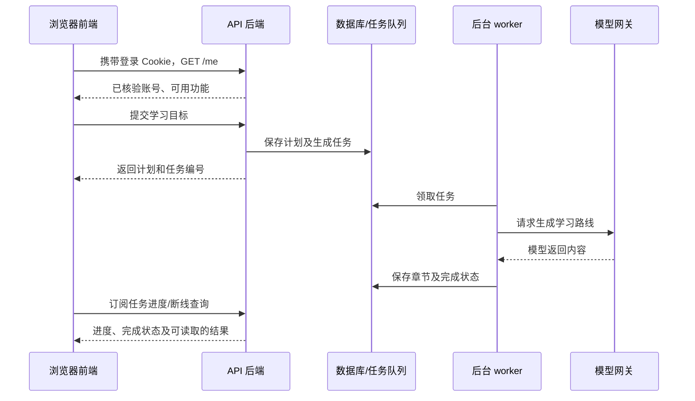

# 前端与账号后端衔接说明

> 2026-11-18 后端接手更新：已集成 PR #10 并补齐创建 requestId、日报按日分页/北京时间日界和断网恢复。下文是前端各轮交付历史，其中“后端待提供幂等”等描述已由 [当前修复与接口记录](pr10-fix-verification.md) 更新；联调请以新记录和生成的 OpenAPI 为准。

更新时间：2026-11-17。账号后端由用户同事负责；本轮仅完善 React 前端和兼容检查，不修改账号、数据库、官网鉴权或生产部署。

## 用本项目理解前后端

| 部分 | 在哪里运行 | 在 AI Learn 中负责什么 |
| --- | --- | --- |
| 前端 `learn_web/` | 用户浏览器 | 页面、表单、按钮、课程排版、PDF/导图、进度和错误提示 |
| API `learn_api/` | 服务器 | 接收 HTTP 请求、校验登录与账号、检查数据格式、调用业务服务 |
| 业务与任务 `learn_core/` | 服务器 API/worker | 保存学习数据、安排生成任务、访问模型网关、测验和复习规则 |
| 数据库与文件存储 | 服务器 | 持久保存账号所属的计划、笔记、资料、任务和结果 |



前后端用 API 通信，不直接共享 React 变量或 Python 函数。JSON 是通信数据；OpenAPI 是双方对字段、地址、方法和错误的共同约定。模型 Key、数据库密码、内部代理密钥只在服务器，不进入页面构建产物。

## 当前已经实现的对接入口

| 文件 | 作用 |
| --- | --- |
| `learn_web/src/api.ts` | 页面调用的业务接口；批量资料删除复用现有逐个 DELETE，无新增服务端批量接口 |
| `learn_web/src/api/client.ts` | 同源请求、Cookie、预期账号头、超时/取消、统一错误处理 |
| `learn_web/src/session/SessionGate.tsx` | 先请求 `/me` 再加载业务；每 120 秒及页面恢复可见时复核 |
| `learn_web/src/session/identity.ts` | 对真实 `/me` JSON 做运行时格式检查；编译时的 TypeScript 类型无法替代此检查 |
| `learn_web/src/session/store.ts` | 内存中的页面账号；换账号/异常身份时停止会话 |
| `learn_web/src/session/official.ts` | 现有官网续期适配；账号实现变化时优先在这一层适配 |
| `learn_web/src/query.ts` | 缓存按页面账号隔离；停止会话时取消并清空缓存 |
| `learn_web/src/api/jobs.ts` | SSE 任务观察，断线查询兜底；会话停止时关闭连接 |

开发地址为 `/api/v2`，默认生产浏览器地址为 `/official/learn-everything/api/v2`，通过同源代理转到 API 的 `/api/v2`。自定义部署需同步配置 `LEARN_WEB_BASE`、`VITE_API_BASE` 和服务器路由；后端内部地址、端口不写进页面组件。

## 账号接口：同事应先对齐的契约

当前实现使用 `GET /api/v2/me`，以下是格式示例，不是真实账号数据：

```json
{
  "userId": "stable-official-user-id",
  "displayName": "学习者",
  "capabilities": {
    "chat": true,
    "jobEvents": true,
    "fileDownload": true,
    "streamChat": false,
    "storage": false
  },
  "storage": null
}
```

- `userId`：必填、非空字符串，不能包含 CR/LF。使用稳定的官网账号身份，不以昵称充当 id，不随登录或刷新变化。新账号系统需要保留旧身份映射；UUID/数字型主键可由服务端映射为此稳定字符串。
- `displayName`：必填字符串。空字符串时前端回退显示 `userId`。
- `capabilities`：必填对象，值必须是 JSON 布尔值；`"true"`、`1` 不兼容。可以追加功能名称；仅对确已实现、可使用的能力返回 true。前端隐藏入口不能代替服务端权限检查。
- `storage`：目前返回 null 或省略均兼容；如果返回对象，各值必须为非负安全整数。字段含义尚未确定，当前前端不把任意值当作空间配额，也不自行推算账号余额。
- 可以追加未知顶层字段，前端身份适配只读取上述字段。字段改名、类型变化、嵌套结构变化应先更新 OpenAPI 和前端适配，不能直接在线替换。
- 格式错误时前端停止会话、清缓存和请求，提示检查账号接口；不会带着空账号继续加载学习数据。网络暂不可用与 5xx 仍走原来的连接失败/重试路径，不伪装成空资料库。

`/me` 必须由服务器核验 Cookie/官网身份后返回；浏览器提交的 `userId`、`X-Learn-User` 不能作为登录依据。业务请求的 `X-Learn-Expected-User` 只用于发现页面账号与服务器账号不一致；SSE 对应参数为 `__le_owner`。这两者均不是授权凭据。

现有官网短票、代理密钥、资格核验、Cookie 转发协议详见 [official-auth.md](official-auth.md)。同事可以替换内部账号实现；如果要更换登录/续期协议，需要同步修改 `official.ts` 和此契约，学习页面不应逐个改登录逻辑。

## 错误格式和前端行为

```json
{
  "error": {
    "code": "TENANT_BUSY",
    "message": "当前任务较多，请稍后重试",
    "retryable": true,
    "retryAfterSeconds": 5
  }
}
```

| HTTP 状态/错误码 | 当前前端处理 | 后端需保证 |
| --- | --- | --- |
| 401 | 停止会话，引导从官网进入 | 不返回其他账号数据 |
| 403 | 视为产品资格失效，停止会话 | 若增加单个资料的权限，应先扩展错误语义和前端处理，避免混用为资格失效 |
| 409 + `ACCOUNT_CHANGED` | 清缓存、取消请求、关闭 SSE | 在读取业务数据前检查预期账号；代理可用 `X-Learn-Error: ACCOUNT_CHANGED` |
| 404 | 对应资源不存在 | 删除资料时可视作目标已不存在；其余操作不等同成功 |
| 429 / 5xx | 提示稍后重试，不自动重放写操作 | 返回一致 JSON；`retryable` 不表示浏览器应自动重复计费操作 |

## 本轮资料批量操作如何衔接

批量删除只在用户核对文件清单并确认后执行。沿用 `DELETE /api/v2/materials/{file_id}`，每次一份、每批最多 50 份，不添加账号或后台批量任务服务。每份删除仍由服务器检查当前账号和文件归属。

成功项从当前账号清单和预览缓存移除；失败项保留选择。用户可仅重试未完成项；404 视为已经不存在。遇到网络问题、限流或服务错误时停止后续请求；“停止后续删除”等待当前请求结果，不撤销已完成删除。离开页面或会话停止后不再发起下一份删除。

用户手动重试时，先前响应丢失的删除可能已经完成，服务端应对重复删除给出成功或 404。权限隔离不能仅依赖文件 id 难以猜测，也不能只在列表接口过滤。

## 建议同事接入时的顺序

1. 先核对稳定账号 id、`/me` 返回格式、Cookie/续期和错误语义；本轮未另建注册或登录页面。
2. 用两个账号验证 `/me`、列表、读取、上传、删除和生成任务的归属隔离。
3. 验证账号 A 页面打开时切到 B：旧页面停止，旧请求和 SSE 关闭，迟到响应不进入页面。
4. 再核对网关可用模型、资格、计费和任务归属。资料、笔记、计划和任务数据全部按服务器核验的身份读取。
5. 更新 OpenAPI 后运行 `python scripts/learn_web/export_openapi.py` 和 `npm --prefix learn_web run api:generate`；检查差异，再执行前端/后端各自的回归。

空间配额字段、真实流式协议、账号迁移和生产部署属于后续需共同对齐的事项；本说明不表示它们已经完成。前端自动化使用隔离模拟接口，真实官网账号、续期、网关费用及 Edge/Safari 仍需线上人工验收。

## 本轮验证记录

2026-11-17：`scripts/ci-check.sh web` 通过，包含供应商目录一致性、OpenAPI 类型检查、32 项单元检查、生产构建、112 项普通浏览器检查和 10 项模型演示检查；格式和 `git diff --check` 通过。新增浏览器场景覆盖批量确认/取消、部分失败后仅重试未完成项、限流/服务故障停止、手动停止、账号切换、批次上限及错误身份响应。390px/1440px 的批量确认弹窗截图已检查。

本轮只修改前端和文档，未修改账号后端，未推送或部署；完整旧平台发布包检查未在本轮运行，推送前仍需按 AGENTS.md 执行全仓库检查。


## 三项新增前端功能的接口衔接（2026-11-17）

1. **上传**继续使用 `POST /projects/{id}/materials`，`multipart/form-data` 文件字段为 `file`，不更改 API 契约。XHR 使用同源凭据和现有预期账号头；浏览器自行生成 multipart 边界。传输到 100% 后等待服务器确认，成功响应后再观察索引任务。取消只能停止浏览器传输/等待，不能承诺撤销服务端已接受的文件；异常时提醒先刷新列表核对，重试由用户发起。上传等待上限为 5 分钟，服务端/代理体积与超时策略仍需联调。
2. **图表**复用项目 reports 和 summary，不新增聚合接口。日报日期缺失与有记录但值为零分别显示；当前学习时长沿用现有日报定义，不把页面停留时间当真实学习时长。用户整理日报后刷新相关缓存。
3. **批注**复用 `GET/POST /projects/{id}/notes` 和 `PATCH/DELETE /notes/{id}`；新建传 `nodeId/selection/content`，编辑传 `selection/content`。`selection` 是引用原文，不是 DOM 路径或字符偏移。账号/项目/章节归属仍由服务端校验。课文改动后引用仍保留，仅在当前教材中唯一匹配时定位；稳定锚点和术语解释需要后续契约。

这些改动没有新增数据库表、后台进程或模型请求。真实上传速度、持久化、多账号隔离和线上 Edge/Safari 全流程仍需实际接口验收。


### 多文件上传的负载与恢复

批量选择复用逐文件上传接口，浏览器限制每批 10 份/100 MB，单份 50 MB；服务端继续做真实体积、类型、配额和归属校验。每个成功响应若带 `jobId`，浏览器复用现有 SSE/查询通道，索引结束后才发送下一份。此限制仅控制当前页面的一批，不能替代服务端全账号/全局并发控制。

不新增批量上传 API，也不自动重试上传或失败索引。网络响应丢失可能已经写入原件，手动重试前提示核对列表；原有按内容去重逻辑仍由服务端负责。已确认接收的原件不会因为后续索引失败而重新传输，索引失败后通过列表原有“重新索引”入口处理。

停止后续上传会等待当前项；离开页面中止本地等待，服务器已接收的任务继续运行。文件内容不写浏览器持久存储，刷新后未发送的队列需重新选择；只恢复当前已知索引任务编号。


2026-11-17 本次最终验证：`scripts/ci-check.sh web` 通过，包含 33 个供应商预设的目录一致性、OpenAPI 类型、41 项单元检查、生产构建、131 项普通浏览器检查、13 项演示浏览器检查；格式及 `git diff --check` 通过。新增覆盖上传字节状态、图表数据/缺失日期、批注 CRUD/定位/失败保留、批量上传串行索引/停止/部分失败重试/账号变化。接口为隔离模拟，未做真实新账号后端、模型费用时延或线上多账号验收。Edge 已确认显示本地 AI Learn 演示页面，本轮未推送或部署。


## 六项学习交互的接口衔接（2026-11-17）

| 前端功能 | 复用接口/契约 | 后端衔接要求 |
| --- | --- | --- |
| 选择题点选 | 现有 quiz/result/grade-jobs | answers 中选择题值为 A/B/C 等字母；保留 questionId、userAnswer、expected、correct、feedback、explanation。判分仍由服务端决定 |
| 笔记管理 | GET/POST /projects/{id}/notes、PATCH/DELETE /notes/{id} | 编辑普通内容只传 content，省略 selection 必须保留原引用；归属/权限由服务端复核 |
| 手动复习卡 | POST /cards | body 为 projectId、nodeId（可 null）、front、back、cardType: basic；201 返回 CardOut，含 nextReview/reps；不经模型任务 |
| 阶段报告 | 现有 reports/summary | 只聚合已加载日报，同日期取最高 id；推进次数不代表独立章节数，不自行补造缺失日记录 |
| Markdown/CSV/打印 | 浏览器读取已有内容生成 | 无新增导出接口；不是完整备份/迁移服务，大数据分页仍待契约 |
| 阅读/批注高亮 | 现有课文与 notes.selection | 引用原文唯一匹配，变化/重复时保留引用并提示；跨版本稳定锚点未定义 |

手动制卡在前端只提供当前计划的章节，但这不构成权限边界。现有 POST /cards 已验证 projectId，服务端还应明确验证 nodeId 的租户归属及其与 projectId 的对应关系；本轮未修改账号后端或该接口。前端提交前的校验不能替代服务端校验。

本轮没有改变模型调用、FSRS 算法或账号协议。写操作失败保留草稿，不自动重试；用户可明确重试。新建卡片响应丢失时可能已保存，应先核对列表，现有 POST /cards 没有新增幂等键契约。


2026-11-17 六项交互最终检查：`scripts/ci-check.sh web` 全程通过（43 项单元、140 项普通浏览器、13 项演示浏览器，另含契约和生产构建）；格式/差异检查通过。详见 frontend-framework.md 的最终验证记录。此轮仅本地代码与示例 UI，未提交、推送或部署；真实账号后端、模型和多人验收不在此结果内。


## 2026-11-17：保存结果不明确时的前后端约定

前端已实现未保存提醒，以及 POST/PATCH 等写请求在超时、断网、5xx 或不可解析成功响应后先核对记录的流程。此类错误不是“肯定失败”：服务器可能已写库但响应丢失。不会自动重发；核对读取失败继续保留草稿并阻止提交，成功读取后用户仍须明确允许再次提交。

核对复用现有 notes/cards/chat GET。新建笔记/批注/卡片仅在已有可靠基线、出现新的记录编号且内容/章节精确匹配时自动确认；编辑按原编号与目标内容确认。同文旧记录不能证明本次创建成功。核对成功只清除仍等于原提交的草稿，新输入保留。列表可能延迟或分页，未找到不代表未写入。

后端后续需为新建笔记、批注和复习卡提供幂等契约：建议由客户端生成请求编号，按账号和操作类型绑定，重复提交相同编号返回原结果，编号对应不同内容时返回明确冲突；明确有效期、原子提交与错误格式。当前没有擅自向旧 API 添加不支持的幂等字段。问答继续使用已有 requestId；服务端需维持其去重/任务归属语义，前端同一提交签名重试沿用原编号。

草稿不落浏览器持久存储，会话停止立即卸载，不阻碍账号隔离。服务端仍负责每项记录和章节的归属校验。这轮只修改 React 客户端，不改账号系统、模型网关或数据库；真实响应丢失、多用户并发和持久化仍需线上联调。
